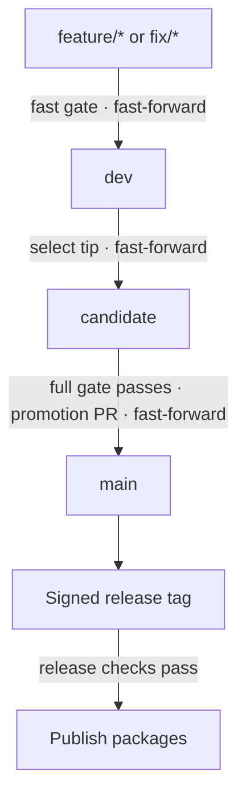

# FormaUI Versioning

How every FormaUI project versions, branches, commits, releases and packages its work. Each project follows one
release of these rules, and states in its own documentation only what is particular to it.

Candidate fixes land on `dev` first, then advance `candidate` and run the full gate again. Failed publication
retries the same tag.

| Document | What it sets out |
| --- | --- |
| [Versions](docs/versions.md) | What carries a version, the stages a version passes through and what each promises, and how a version advances |
| [Branches](docs/branches.md) | The three branches, how work reaches them, and how a candidate is stabilized |
| [Releases](docs/releases.md) | How a candidate becomes a release: promotion, the tag, the checks before each step, publication and the release record |
| [Commits](docs/commits.md) | What a commit holds and how its message is written |
| [Packages](docs/packages.md) | What a package holds, how it declares its dependencies and metadata, how it's verified and how consumers receive it, on npm and on NuGet |

## Projects

| Project | Repository | Its versions |
| --- | --- | --- |
| Forma | [FormaUI/Forma](https://github.com/FormaUI/Forma) | Its packages |
| Locali | [FormaUI/Locali](https://github.com/FormaUI/Locali) | Its tool's package |
| Nexo | [FormaUI/Nexo](https://github.com/FormaUI/Nexo) | Its packages, and the Nexo language |
| DOMQL | [FormaUI/DOMQL](https://github.com/FormaUI/DOMQL) | Its packages, and the DOMQL specification |

## What a project states itself

Each project states, in its own documentation:

- its public contract, which the stages' promises cover;
- the declaration of each of its versions;
- its fast gate and its full gate, and the workflow that runs the full gate on a candidate;
- its packages: each one's id, the files it holds, the targets it supports, its feeds, the packages of its own it
  depends on, and the commands that verify it;
- the workflow that publishes a release;
- its changelog, and the history of each contract it defines.

## Versioning's releases

Versioning follows its own rules, and states here what they leave to a project:

- **Its public contract** is these rules: what a project following a release does, and what the checks hold it to.
  A change that leaves a project following the release before it out of compliance, or makes a check refuse what it
  accepted, breaks the contract; a rule a project may take up is an addition; a rewording that changes no
  obligation is a fix.
- **Its version** is declared in [`VERSION`](VERSION), and the [changelog](CHANGELOG.md) records each release.
- **Its gate,** `./build.ps1`, checks that every link and anchor the documents give resolves and that `VERSION`
  and the changelog's newest entry agree, and runs the cases of the functions the checks share. It's both its fast
  and its full gate, and `ci.yml` runs it.
- **It publishes no package,** so a release is its tag alone. Its `promotion.yml` and `release.yml` run the checks
  from the commit they check.

## The checks

Versioning ships the promotion check, the release check and the step that attaches a release's packages as GitHub
Actions. A project's workflows call them by the full commit SHA of the Versioning release it follows, with the version
in a comment beside it.

| Action | Where a project calls it | What it does |
| --- | --- | --- |
| [`actions/promotion-check`](actions/promotion-check/action.yml) | In the workflow a pull request into `main` runs, with the pull request's head commit checked out | Holds the pull request to the [promotion check](docs/releases.md#promotion) |
| [`actions/release-check`](actions/release-check/action.yml) | First in the workflow a release tag's push runs, with the tag checked out | Holds the tag to the [release check](docs/releases.md#the-release-check), and gives the release's version and its full-gate run |
| [`actions/release-packages`](actions/release-packages/action.yml) | After the release check, before anything is published | Attaches the full-gate run's packages to the tag's GitHub release with their digests, or takes the ones attached already, and saves them for the workflow to [publish](docs/releases.md#publication) |

- **The full-gate workflow** uploads the packages it built and verified as an artifact, under the name the actions
  take as `packages-artifact`, kept for as long as GitHub allows.
- **The promotion check reads the full-gate run,** so the pull request is opened once the candidate's full run has
  passed, or its check runs again once it has.
- **The release workflow publishes** what `release-packages` saved, through each feed's trusted publishing, past
  what a feed already holds.
- **The checks read** with `contents: read`, `actions: read` and `pull-requests: read`, and `release-packages` writes
  the release with `contents: write`.

## Following a release

A project follows one release of Versioning. It links to these documents at that release's tag, as
`https://github.com/FormaUI/Versioning/blob/<tag>/docs/versions.md`, and refers to anything else of Versioning's
it uses, a workflow among them, by that release's full commit SHA, with the version in a comment beside it.
Moving to a later release is a change of its own in each project.
