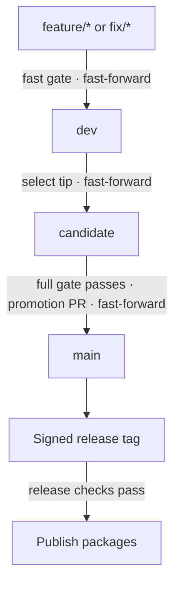

# FormaUI Versioning

How every FormaUI project versions, branches, commits and releases. Each project follows one release of these
rules, and states in its own documentation only what is particular to it.

Candidate fixes land on `dev` first, then advance `candidate` and run the full gate again. Failed publication
retries the same tag.

| Document | What it sets out |
| --- | --- |
| [Versions](docs/versions.md) | What carries a version, the stages a version passes through and what each promises, and how a version advances |
| [Branches](docs/branches.md) | The three branches, how work reaches them, and how a candidate is stabilized |
| [Releases](docs/releases.md) | How a candidate becomes a release: promotion, the tag, the checks before each step, publication and the release record |
| [Commits](docs/commits.md) | What a commit holds and how its message is written |

## Projects

| Project | Repository | Its versions |
| --- | --- | --- |
| Forma | [FormaUI/Forma](https://github.com/FormaUI/Forma) | Its packages |
| Locali | [FormaUI/Locali](https://github.com/FormaUI/Locali) | Its tool's package |
| Nexo | [FormaUI/Nexo](https://github.com/FormaUI/Nexo) | Its packages, and the Nexo language |
| DOMQL | [FormaUI/DOMQL](https://github.com/FormaUI/DOMQL) | Its packages, and the DOMQL specification |

## What a project states itself

Each project states, in its own documentation:

- its public contract, which the stages' promises cover;
- the declaration of each of its versions;
- its fast gate and its full gate, and the workflow that runs the full gate on a candidate;
- the workflow that publishes a release, and the feeds it publishes to;
- its changelog, and the history of each contract it defines.

## Following a release

A project follows one release of Versioning. It links to these documents at that release's tag, as
`https://github.com/FormaUI/Versioning/blob/<tag>/docs/versions.md`, and refers to anything else of Versioning's
it uses, a workflow among them, by that release's full commit SHA, with the version in a comment beside it.
Moving to a later release is a change of its own in each project.
